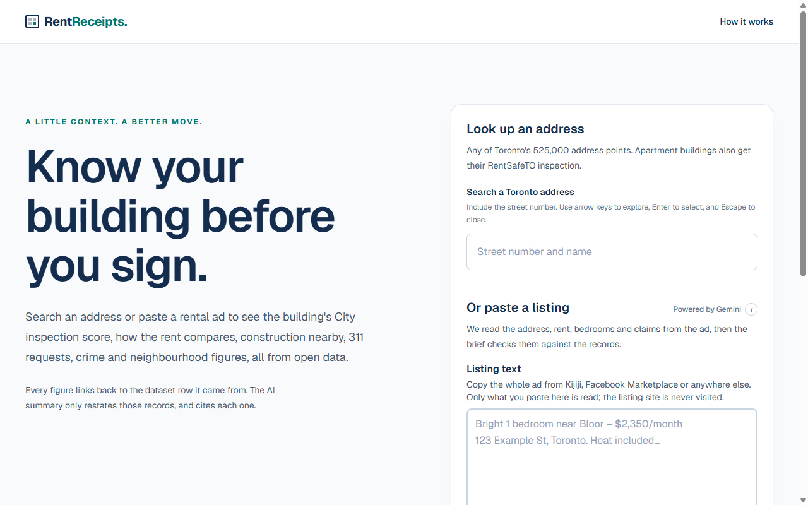
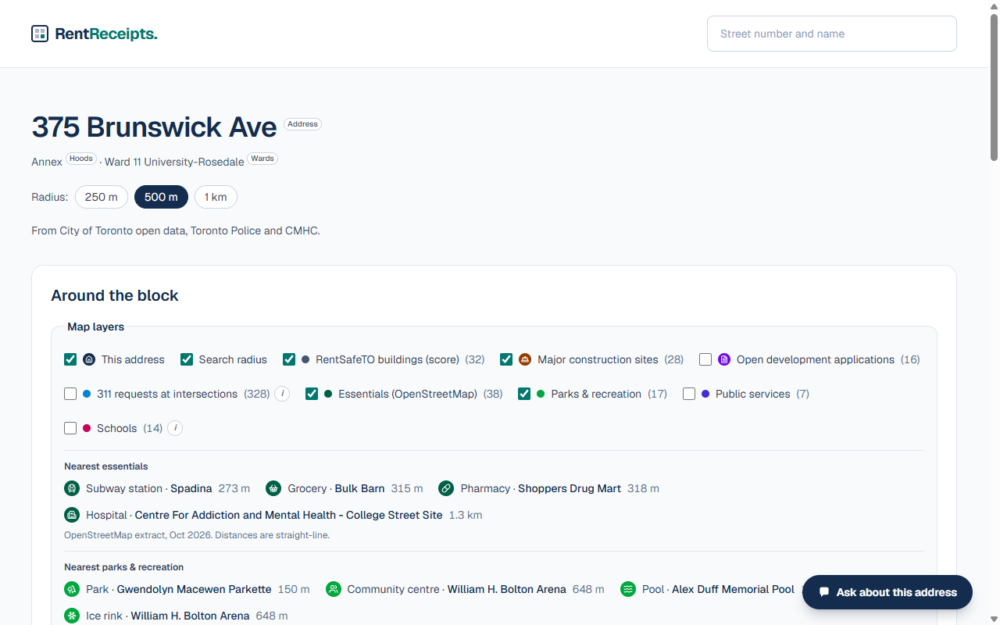

# RentReceipts

**Know your building before you sign.** Look up a Toronto rental address, or paste a rental ad,
and see the building's City inspection score (for apartment buildings), how the rent compares,
construction nearby, 311 requests, crime and neighbourhood figures.
Every figure links back to the dataset row it came from.

Built at **Hack The Valley 11** (October 2026).

**Live:** [www.readreceipt.work](https://www.readreceipt.work)



## What it does

- **Search any of Toronto's ~525,000 address points**, or **paste a rental ad** (text or a
  screenshot). Gemini reads the address, rent, bedrooms and claims out of the ad; the listing site
  itself is never visited.
- **What to flag:** up to three things that stand out for this address, such as a low inspection
  score, rent above the market average or heavy construction nearby, each with a chart and
  citations.
- **Building** (apartment buildings with 3+ storeys and 10+ units): the RentSafeTO inspection
  score against the city median, its lowest-scoring categories and history, plus registration details (heating, cooling, manager) and a rent-control
  estimate from the year built.
- **Rent:** the asking rent against CMHC's Rental Market Survey averages.
- **Ad check:** each claim from a pasted ad is marked confirmed, challenged or can't-check against
  the records, with citations.
- **Around the block:** an interactive map with RentSafeTO buildings, major construction,
  development applications, 311 requests, subway stations, groceries, pharmacies, parks, schools and public
  services, a 3D buildings view, and neighbourhood shading (shelter cost, crime, noise and more).
- **Nearby buildings:** inspection scores of the apartment buildings around the address.
- **Neighbourhood, crime, construction and 311 tabs:** 2021 Census figures, Toronto Police crime
  rates against the city, permits and development applications nearby, and a construction & noise
  score.
- **Ask about this address:** a chat that answers questions only from the records, where every
  line must cite a source row and every number must appear in the cited data.
- **Reviews:** renters can leave a rating and comment (unverified).
- **About the data:** what each dataset can and can't tell you.



**Built with** Next.js 16, React 19, Tailwind CSS 4, MapLibre (OpenFreeMap tiles), Supabase
(Postgres + PostGIS), Google Gemini, and a Python loader for the open data. Hosted on Vercel.

**Team:** [@ariaz123git](https://github.com/ariaz123git),
[@Edwardddyang](https://github.com/Edwardddyang), [@ogd-ola](https://github.com/ogd-ola) and
[@Satwik934](https://github.com/Satwik934).

---

The rest of this file is for developers.

## How it works

- **Data layer:** drop the downloaded files into `data/raw/`, check them, and load them into
  Supabase (Postgres + PostGIS) with the `bb` command.
- **Brief:** SQL functions build a facts-only brief for an address, and the Next.js app serves it.
  Every fact cites the dataset row it came from.
- **AI (Gemini):** reads pasted listings, checks their claims, and answers questions. Its output is
  checked in code: a line without a valid citation, or with a number that isn't in the cited data,
  is dropped. The ad check falls back to rule-based results when Gemini isn't available.

Besides City of Toronto open data, the app uses Toronto Police crime rates, the CMHC Rental Market
Survey, and an OpenStreetMap extract (subway stations, groceries, pharmacies, hospitals with an emergency
department).

## Layout

```
data/raw/<dataset>/      drop downloaded files here (each folder's README says which file)
etl/                     Python loader (`bb` command)
  blockbrief_etl/sources/  one module per dataset: how its file is read and cleaned
supabase/migrations/     0001 tables, 0002 read-only API access + brief functions, 0003 registrations
                         + CMHC rents, 0004 RentSafeTO city stats, 0005 reviews, 0006/0008 construction
                         nearby, 0007 address search prewarm, 0009 API statement timeout
web/                     Next.js app: pages, API routes, Gemini features (src/lib/ai)
  public/*.json, scripts/  map extracts (OpenStreetMap, City facilities, neighbourhood shading)
deploy/                  alternative Docker Compose + Caddy setup for a single VM (see deploy/README.md)
```

## Web app

Needs Node 22.18+. Point `NEXT_PUBLIC_SUPABASE_URL` and the publishable key at your own Supabase
project, and load the data first (Data setup below). `GEMINI_API_KEY` is optional; without it,
paste-a-listing and Ask are off and the ad check uses rules only.

```sh
cd web
cp .env.example .env.local     # then fill in your own values
npm install
npm run dev
npm test                       # unit tests (src/lib/**/*.test.ts)
```

Pages: `/` (search and paste a listing) and `/building/<address_point_id>?r=500` (the brief;
`r` is 250, 500 or 1000).

API routes:

- `GET /api/brief?address=100 Queen St W&radius=500` (radius 100–1000 m, default 500), or
  `?id=<address_point_id>` to pick one of the returned `alternatives`.
- `GET /api/geocode?q=100 queen` returns up to 5 address matches, for autocomplete.
- `POST /api/listing` (read a pasted ad), `/api/adcheck` (check its claims), `/api/ask` (questions)
  and `/api/summary` (flags and viewing checklist; built but not shown in the UI yet) use Gemini.
- `GET`/`POST /api/reviews` lists, posts and reports reviews.

The brief has these sections, each fact with a `cite` (`dataset`, `file`, `row`, or `row_count`
plus `sample_rows` for counts): `address`, `area` (neighbourhood, ward), `building` (RentSafeTO
score, history, lowest-scoring items, percentile), `permits_at_address`, `construction_nearby`
(active permits, notable projects), `development_applications` (open ones nearby),
`rentsafe_nearby` (RentSafeTO buildings in the radius), `service_requests_311` (placed requests nearby, plus ward totals), `crime` (neighbourhood vs city
rates), `census` (rent, renters, shelter costs, income, dwellings, commute vs the neighbourhood
median). `summary` in this response is always `null`; the AI summary has its own route.

The logic lives in `supabase/migrations/0002_brief.sql` (`bb_geocode`, `bb_brief`). The API
roles can read the open-data tables and call the `bb_*` functions; reviews are written only through
`bb_add_review` and `bb_report_review`. Supabase's anonymous role has an 8 s statement timeout
(0009), and the brief's SQL takes ~0.2–0.8 s (the first one after a data load is slower).

## Data setup (once)

Needs [uv](https://docs.astral.sh/uv/). It uses or installs Python 3.12+ for this project by itself.

```sh
cd etl
uv sync
# create ../.env with one line: DATABASE_URL=<your Supabase session pooler connection string>
uv run bb init-db              # creates the tables (safe to re-run)
# after changing supabase/migrations: uv run bb reset-db --yes  (drops and recreates, then reload)
```

## Workflow

From `etl/`:

```sh
uv run bb status                    # which folders have files
uv run bb check rentsafe            # clean the files and preview the result (no database needed)
uv run bb load address_points       # load into Supabase; replaces that dataset's rows
uv run bb load all                  # everything, in dependency order
uv run bb near "100 Queen St W"     # smoke test: what's loaded around an address
uv run python -m unittest discover -s tests -v   # loader tests
```

`bb load all` loads in dependency order. Rows with a location are written in spatial order so a
radius query reads a few disk pages, not one per row (6x fewer for permits downtown). Loading one at a time: `address_points` before
`building_permits` (permits get their location from their `GEO_ID` address point), and
`intersections` before `service_requests_311` (requests reported at a corner get its point).

## Datasets

| Folder | Dataset | Table(s) |
|---|---|---|
| `address_points` | Address Points (Municipal) | `address_points` |
| `wards` | City Wards, 25-ward model | `wards` |
| `neighbourhoods` | Neighbourhoods, 158 model | `neighbourhoods` |
| `rentsafe` | Apartment Building Evaluations (RentSafeTO) | `rentsafe_evaluations` |
| `apartment_registrations` | Apartment Building Registration | `apartment_registrations` |
| `building_permits` | Building Permits: all active, cleared ones completed since 2025 | `building_permits` |
| `development_applications` | Development Applications | `development_applications` |
| `intersections` | Intersection File (Centreline Intersection) | `intersections` |
| `service_requests_311` | 311 Service Requests, customer initiated (one year only) | `service_requests_311`, `sr311_request_types` |
| `crime_rates` | Neighbourhood Crime Rates (TPS) | `crime_rates`, `neighbourhood_population` |
| `neighbourhood_profiles` | Neighbourhood Profiles, 2021 Census | `neighbourhood_profiles`, `neighbourhood_profile_variables` |
| `ward_profiles` | Ward Profiles, 2021 Census | `ward_profiles` |
| `cmhc_rents` | CMHC Rental Market Survey, Toronto | `cmhc_rents` |

Every row stores `source_id` (→ `sources`: dataset + file name) and `source_row_id` (the file's
`_id`, or its row number when it has none), so the AI can cite exactly which record a claim
came from.

## Storage budget (Supabase free tier, 500 MB)

The original datasets came to ~457 MB, leaving ~40 MB for app data such as reviews. To fit,
cleared permits are limited to those completed since 2025 (`CLEARED_SINCE` in
`sources/building_permits.py`) and 311 to one year.

## Things the data does and doesn't contain

- **311 requests have no coordinates and no closed date.** Location is a postal FSA (e.g. `M4L`),
  an intersection, or the ward, so "time to resolve" can't come from this file. Requests
  reported at an intersection (~19%) are placed on it when the two street names identify
  exactly one intersection: 71,799 of 82,511 in 2026. The rest have no point. The City's
  Open311 API, which had locations, was retired in 2021 and now returns 403.
  The 2026 file is Windows-1252 encoded, and about 9% of its rows have an unquoted comma
  ("Environment, Climate & Forestry"). The loader repairs both and prints any row it can't.
- **Building permits have no coordinates.** They are placed via `GEO_ID` = Address Points
  `ADDRESS_POINT_ID`.
- **Development applications use X/Y in EPSG:7991** (NAD27 / MTM zone 10). Checked against
  RentSafeTO rows that have both: median error ~10 m. 43 rows are in UTM 17N instead and are
  converted as such; points outside Toronto are dropped.
- **Crime is per neighbourhood per year**, not per incident. Rates per 100k are TPS's own.
  Blank cells mean no incidents (the file never contains a literal 0) and are stored as 0.
- **RentSafeTO** has two files with different scoring categories. One row's year evaluated
  is "202510"; impossible years are stored as null (its evaluation date is intact). Shared fields are columns;
  the per-category scores are in `item_scores` (JSON).
- Staff contact details (development applications) and builder names (permits) are not loaded.

## Future ideas

- **Compare other homes nearby.** Click any nearby address with a live listing and open its brief in a new tab,
  for the renter whose chosen unit is overpriced, poorly rated or badly managed but who likes the area. It needs
  listing data for any building (not only RentSafeTO's 3+ storey, 10+ unit buildings), which the open data
  doesn't have, so it is out of scope for now.
